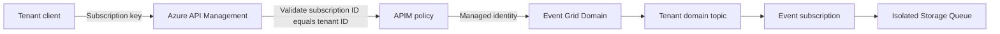

# Multi-Tenant APIM to Event Grid

This repository demonstrates a scalable multi-tenant event-ingestion pattern on Azure. Clients publish events through Azure API Management (APIM), APIM authorizes each client for one tenant, and an APIM managed identity publishes the event to an Azure Event Grid Domain.

Each tenant receives an isolated Event Grid domain topic and Storage Queue. Adding tenants changes Terraform data, not the APIM policy.

## Project Status and Intended Use

This repository is a demonstration and reference implementation, not a production-ready Azure landing zone or a managed service. It has been functionally tested with the included sample tenants. The configuration can generate hundreds of tenant resources, but a live 500-tenant deployment, its throughput, deployment duration, quotas, and cost have not been validated by this project.

Before production use, perform an architecture and security review, load and failure testing, Azure quota verification, cost estimation, monitoring design, backup and recovery planning, and compliance validation for the target environment. Azure resources created by this project incur charges in the selected subscription.

The software is provided under the MIT License on an "AS IS" basis, without warranties or guarantees. You are responsible for reviewing Terraform plans, protecting credentials and state, validating suitability for your workload, and all Azure costs and operational consequences. See [LICENSE](LICENSE) for the complete terms.

## Quick Start

Create an ignored local variable file from the public example, then replace the placeholder values for your environment. Terraform loads `terraform.tfvars` automatically.

```powershell
Copy-Item terraform.tfvars.example terraform.tfvars
terraform init
terraform plan
terraform apply
```

Run the complete automated test suite after a successful apply:

```powershell
.\test-solution.ps1
```

Run a manual request by replacing the APIM name, API path, tenant ID, and APIM subscription key with values from the deployed environment:

```powershell
curl.exe -i -X POST `
  "https://<apim-name>.azure-api.net/<api-path>/<tenant-id>" `
  -H "Content-Type: application/json" `
  -H "Ocp-Apim-Subscription-Key: <apim-subscription-key>" `
  -d '{"hello":"world"}'
```

See [TESTING.md](TESTING.md) for individual automatic scenarios, safe subscription-key retrieval, expected results, and the complete manual procedure.

## Architecture



The solution uses two separate trust boundaries:

1. The client authenticates to APIM with a tenant-scoped APIM subscription key.
2. APIM authenticates to Event Grid with the user-assigned managed identity `apim-mi`.

Event Grid credentials are never distributed to clients.

## Use Case

Consider a SaaS platform that receives order events from hundreds of customer organizations:

- Contoso uses tenant ID `tenantA`.
- Fabrikam uses tenant ID `tenantB`.
- Each customer receives a separate APIM subscription key.
- Contoso can publish to `/events/tenantA`, but receives HTTP `403` for `/events/tenantB`.
- Accepted events are routed to the customer's Event Grid topic and queue.
- New customers are onboarded through one entry in the Terraform tenant map.

This pattern is useful when a centralized ingress API must enforce tenant isolation while downstream consumers require separate event streams.

## Repository Contents

| File | Purpose |
|---|---|
| `eventgrid.tf` | Provisions APIM and its policy, Event Grid, Storage, managed identity, RBAC, and tenant resources |
| `variables.tf` | Defines configurable values, required inputs, defaults, and validation rules |
| `outputs.tf` | Exposes non-secret applied settings to the PowerShell scripts |
| `terraform.tfvars.example` | Example override file for another environment |
| `terraform.500-tenants.tfvars.example` | Publishable scale-test example that generates `tenant1` through `tenant500` |
| `terraform-config.ps1` | Loads `deployment_config` from the repository state as a validated PowerShell object |
| `CONFIGURATION.md` | Complete variable reference and override examples |
| `test-solution.ps1` | Runs tenant access-control, delivery, and direct-access security tests |
| `TESTING.md` | Guided testing procedure, scenarios, expected results, and troubleshooting |
| `SCALABILITY.md` | Explains scaling, security choices, and alternatives |
| `SECURITY.md` | Defines vulnerability reporting, credential handling, and production hardening guidance |
| `SUPPORT.md` | Defines the best-effort support scope and Azure support boundary |
| `CONTRIBUTING.md` | Defines contribution and validation requirements |
| `CODE_OF_CONDUCT.md` | Defines expected conduct in project spaces |
| `CHANGELOG.md` | Records notable changes for public releases |

## Prerequisites

- Terraform 1.15.8
- PowerShell 7 recommended
- Azure PowerShell modules: `Az.Accounts` and `Az.Storage`
- Permission to create the resources and role assignments in the target Azure subscription

Authenticate before deploying:

```powershell
Connect-AzAccount
Set-AzContext -SubscriptionId "<azure-subscription-id>"
```

Deployment and complete functional testing require Azure subscription access. Deployment commonly needs `Contributor` plus `User Access Administrator` at the target scope. Test-only operators need permission to list APIM subscription secrets and Storage Account keys; `Reader` alone is not sufficient. See [TESTING.md](TESTING.md#azure-access-required) for the per-test matrix, recommended scopes, and the source of tenant names, topics, queues, endpoints, and subscription keys.

## Deploy

Reusable deployment settings are defined in `variables.tf`. Environment-specific values are required inputs. Use `terraform.tfvars.example` as the public template and store actual values in an ignored local `terraform.tfvars` file.

Create the local file, provide all required values, then initialize and apply Terraform:

```powershell
Copy-Item terraform.tfvars.example terraform.tfvars
terraform init
terraform fmt -check
terraform validate
terraform plan
terraform apply
```

Review every plan before approving it, especially any replacement or destruction of the APIM service.

The APIM parent service and tenant subscriptions are managed by the AzAPI provider. This avoids the AzureRM provider's legacy developer-portal and subscription-key reads, which can return intermittent HTTP `401` responses. Subscription resources also retry transient APIM control-plane `401` responses. APIM APIs, operations, and policies remain managed by AzureRM.

The same configuration supports both `terraform apply` and `terraform destroy`; no lifecycle block needs to be changed between operations. A destroy-time AzAPI action purges the APIM soft-deleted record after deleting the service, so the same APIM name can be recreated by a later apply. This purge permanently removes the deleted APIM service. Always review and save a destroy plan before applying it.

Terraform deploys the API-level APIM policy and stores the applied non-secret configuration in the `deployment_config` output. The test runner reads this output, so resource names and endpoints do not need to be duplicated in the script.

The policy performs the following actions:

1. Reads `{tenantId}` from `/events/{tenantId}`.
2. Compares it with `context.Subscription.Id`.
3. Returns HTTP `403` when the identifiers differ.
4. Converts the request body to the Event Grid schema.
5. Publishes to Event Grid using the APIM managed identity.

See [CONFIGURATION.md](CONFIGURATION.md) for the complete variable reference and override examples.

## Add a Tenant

The current default map contains three demonstration tenants: `tenantA`, `tenantB`, and `tenantC`. These names are example tenant IDs; `tenantC` is not a Terraform attribute or reserved value.

Each entry has two distinct names:

- The map key, such as `contoso`, is the logical and public tenant ID. Terraform uses it unchanged as the APIM subscription ID, Event Grid domain topic name, `/events/<tenant-id>` route value, and Event Grid event `topic` value.
- `queue_name`, such as `contoso-events`, is the physical Azure Storage Queue that receives that tenant's events. It is an internal destination and does not need to equal the tenant ID.

Use these naming constraints:

| Value | Constraints | Scope and usage |
|---|---|---|
| Tenant map key | 3-50 characters; start with a letter; end with a letter or number; use only letters, numbers, and hyphens | Must be unique in the map. Use the exact same spelling and capitalization in the API route because the APIM authorization comparison is case-sensitive. |
| `queue_name` | 3-63 characters; lowercase letters, numbers, and hyphens only; start and end with a letter or number; no consecutive hyphens | Must be unique within the Storage Account. It is not exposed as the client identity. |

For example, add a tenant whose public ID is `contoso` and whose destination queue is `contoso-events`:

```hcl
contoso = {
  queue_name = "contoso-events"
}
```

Add the entry to the default `tenants` map in `variables.tf`, or override the complete map in `terraform.tfvars`. A `.tfvars` map override replaces the entire default map, so include every tenant that must remain managed.

Then deploy:

```powershell
terraform plan
terraform apply
```

Terraform creates the APIM subscription, Event Grid domain topic, Storage Queue, and Event Grid subscription automatically. The APIM policy does not change.

Treat both names as stable identifiers. Changing the map key causes Terraform to replace the tenant-scoped resources and changes the client's route and APIM subscription. Changing `queue_name` replaces the destination queue; plan data migration before renaming a queue that contains messages.

For larger environments, pass the tenant map through a non-committed `.tfvars` file or an automated onboarding pipeline.

## Microsoft Entra ID Alternative

APIM subscription keys are simple, but Microsoft Entra ID is generally preferable when clients are workforce users, managed identities, or registered applications. In that model:

1. Clients obtain an OAuth 2.0 access token.
2. APIM validates the token with `validate-jwt`.
3. APIM derives the authorized tenant from a trusted claim or application mapping.
4. APIM continues to publish to Event Grid using `apim-mi`.

Do not disable APIM subscription requirements until JWT validation is deployed and tested. See [SCALABILITY.md](SCALABILITY.md) for policy examples and design considerations.

## Security Notes

- APIM is deployed with public network access enabled and without VNet integration or an IP allowlist. Add the network controls required by your threat model before production use.
- Event Grid remains reachable through its public endpoint, but publishing still requires Microsoft Entra authentication and the `EventGrid Data Sender` RBAC role assigned to the APIM managed identity.
- The Storage Account remains reachable through its public network endpoint, but anonymous public access to nested Storage resources is disabled.
- Storage shared-key authorization remains enabled because the test runner reads queue messages with an account key. Prefer Microsoft Entra authorization and disable shared-key access for production workflows that do not require the included tests.
- Never commit APIM keys, client secrets, access tokens, `.tfvars`, or Terraform state.
- Terraform state can contain sensitive values even when CLI output marks them as sensitive.
- Store client credentials in Azure Key Vault or a repository secret store.
- Rotate any credential that has previously been exposed.
- Restrict who can call the APIM `listSecrets` management operation.
- Review Azure service quotas, regional availability, SKU capacity, and estimated cost before deployment, especially before onboarding hundreds of tenants.

See [SECURITY.md](SECURITY.md) for credential-handling guidance.

## Cleanup

Review the destroy plan before removing the demo resources:

```powershell
terraform plan -destroy
terraform destroy
```

`terraform destroy` removes the resources managed by this state, including tenant queues and their messages. The destroy-time APIM purge permanently removes the soft-deleted APIM service. Export any required data and verify the selected subscription, workspace, and state before approving destruction.

## Troubleshooting

| Symptom | Likely cause |
|---|---|
| APIM returns `401` | Missing, invalid, inactive, or wrong tenant subscription key |
| APIM returns `403` | Subscription ID does not match `{tenantId}` |
| Event Grid returns `401` or `403` | Managed identity or `EventGrid Data Sender` assignment is missing |
| Test times out waiting for a queue message | Event Grid subscription, queue destination, or delivery is unhealthy |
| Terraform times out while reading one of many Event Grid subscriptions | Transient Azure Resource Manager or network failure during refresh; see [Event Grid refresh timeouts](#event-grid-refresh-timeouts) |
| Policy appears empty in the portal | Select **All operations**, then open the inbound policy code editor |

### Event Grid Refresh Timeouts

At large tenant counts, Terraform can fail while retrieving scoped Event Grid subscriptions with errors such as `dial tcp ...:443: connectex`, `HTTP response was nil`, or `connection may have been reset`. These messages indicate a transient connection failure while Terraform is issuing many concurrent Azure Resource Manager reads. They are not explicit Azure throttling unless the response is HTTP `429 Too Many Requests`.

Retry the normal refreshed plan with lower concurrency and the variable file used by the deployment:

```powershell
terraform plan -var-file="scale-test.tfvars" -parallelism=2 -out="scale-test.tfplan"
```

If connection failures continue, retry with `-parallelism=1`. The failing tenant names may change between attempts when the issue is concurrency or network related. Do not use `-refresh=false` for the final plan because it can hide drift. Review a successful refreshed plan before applying it.

## License

Licensed under the [MIT License](LICENSE). The license includes the applicable warranty and liability limitations.

Participation is also subject to the [Code of Conduct](CODE_OF_CONDUCT.md). See [SUPPORT.md](SUPPORT.md) for support boundaries and [SECURITY.md](SECURITY.md) for private vulnerability reporting.
